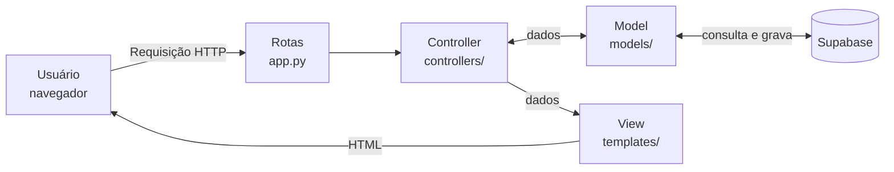

# Arquitetura do site (padrão MVC)

O site usa o padrão **MVC** (Model, View, Controller), que separa o código em três camadas. Assim, cada parte tem uma única responsabilidade e fica mais fácil de entender, testar e mudar.

## As três camadas

| Camada | Pasta | Responsabilidade | Exemplos |
|---|---|---|---|
| **Model** (modelo) | `models/` | Regras do negócio e acesso aos dados (Supabase). Não conhece páginas HTML. | Somar o carrinho, salvar o pedido, entrar na conta, trocar a senha |
| **View** (visão) | `templates/` e `static/` | O que o cliente vê: páginas HTML e visual (CSS, fotos). | Cardápio, carrinho, login, minha conta |
| **Controller** (controlador) | `controllers/` | Recebe o pedido do navegador, chama o Model e escolhe qual View mostrar. | "Cliente clicou em Adicionar": coloca no carrinho e volta ao cardápio |

## Caminho de um pedido do cliente



Exemplo, ao clicar em **Adicionar** num cupcake:
1. O navegador envia o pedido `POST /add/1`.
2. A rota (`controllers/loja_controller.py`) chama o **Controller** `adicionar`.
3. O Controller pede ao **Model** `models/carrinho.py` o novo carrinho e o guarda na sessão do cliente.
4. O Controller manda o cliente de volta ao cardápio, uma **View** (`templates/index.html`), agora com o contador do carrinho atualizado.

## Mapa dos arquivos

```
app.py                          Liga tudo: cria o site e registra as rotas
configuracao.py                 Lê as chaves do .env (nada secreto no código)

models/
  banco.py                      Conexão com o Supabase
  carrinho.py                   Regras do carrinho (adicionar, remover, total)
  produto.py                    Produtos do banco e fotos dos sabores
  pedido.py                     Mensagem do WhatsApp e gravação do pedido
  usuario.py                    Cadastro, login, nova senha, exclusão de conta

controllers/
  loja_controller.py            Cardápio, carrinho, finalizar pedido
  conta_controller.py           Cadastro, login, nova senha, minha conta, excluir conta
  pwa_controller.py             Arquivos do app instalável

templates/                      Views (páginas HTML)
static/                         CSS, fotos, ícones, manifesto, service worker
tests/                          Testes automáticos
```

## Decisões de projeto

- **Erros tratados:** o Model traduz erros técnicos do Supabase para frases simples (`ErroUsuario`). O cliente nunca vê mensagens técnicas, e o detalhe vai para o log do servidor.
- **Segurança:** as chaves ficam em variáveis de ambiente. A chave `service_role`, usada só para excluir contas, nunca sai do servidor. A tela de "esqueci minha senha" responde sempre igual, para não revelar quais e-mails têm cadastro.
- **Testabilidade:** o Model não depende de páginas e a conexão com o banco é isolada em `models/banco.py`. Por isso os testes trocam o Supabase por um "banco de mentira".
- **Banco de dados:** Supabase, que usa PostgreSQL (banco relacional popular e de fácil manutenção). O script de criação das tabelas está em `supabase.sql`.
