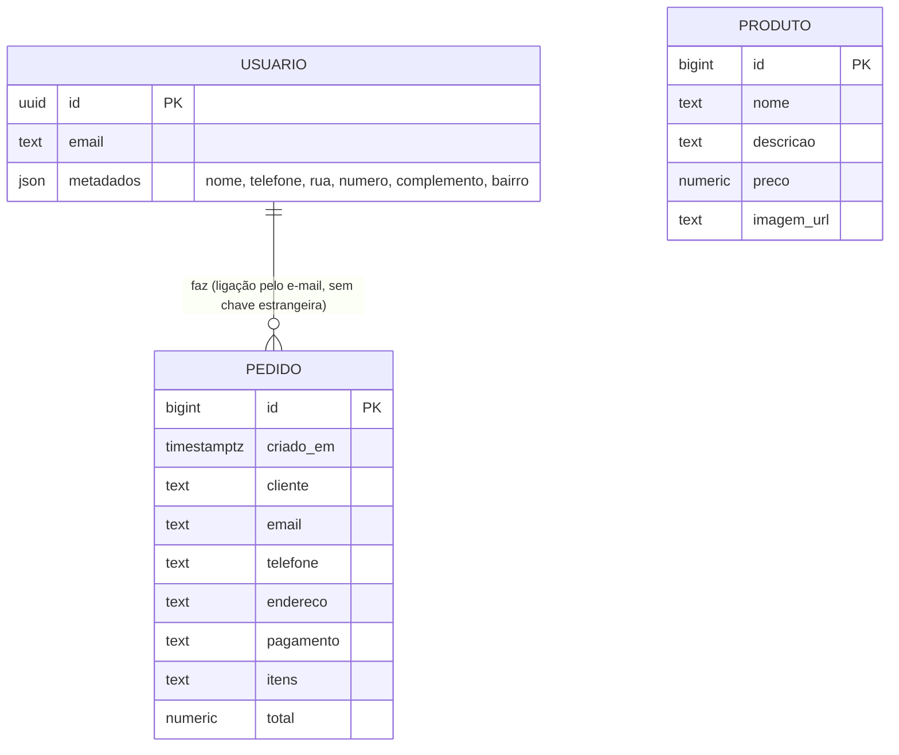
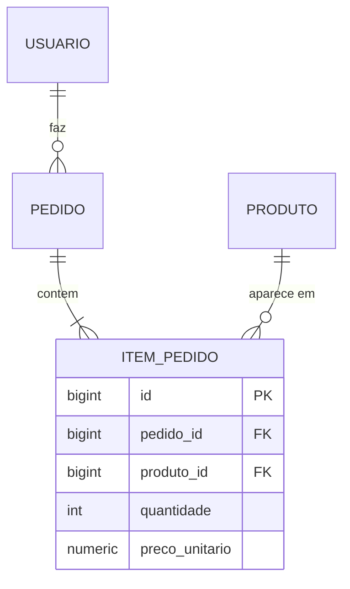

# Dicionário de Dados – Doce Arte Cupcakes

Projeto Integrador Transdisciplinar em Engenharia de Software II · Versão 1.0 · novembro de 2026

Este documento descreve o **projeto físico do banco de dados** do site: as tabelas, os campos, os tipos, as regras e as permissões. O script que cria tudo está no arquivo [`supabase.sql`](../supabase.sql).

## 1. Visão geral

| Item | Descrição |
|---|---|
| **SGBD** | PostgreSQL, oferecido pelo **Supabase** (banco relacional popular e de fácil manutenção) |
| **Tabelas do site** | `produtos` e `pedidos` |
| **Contas de clientes** | Guardadas no **Supabase Auth** (`auth.users`), um serviço do próprio Supabase |
| **Carrinho de compras** | **Não fica no banco**: fica na sessão do navegador do cliente até o pedido ser finalizado |
| **Segurança** | RLS (Row Level Security) ativado nas duas tabelas, com permissões mínimas |

## 2. Modelo de dados atual (DER)

A tabela `PRODUTO` não se liga diretamente a `PEDIDO`: os itens de cada pedido são guardados como texto dentro do próprio pedido (veja a seção 6).

## 3. Tabela `produtos`

**Descrição:** os cupcakes à venda no cardápio. É lida em toda visita à página inicial.

| Campo | Tipo | Obrigatório | Chave | Padrão | Descrição | Exemplo |
|---|---|---|---|---|---|---|
| `id` | `bigint` (identidade, gerado automaticamente) | Sim | **Chave primária** | Gerado pelo banco | Número que identifica o produto. Também é usado no carrinho | `1` |
| `nome` | `text` | **Sim** | | | Nome do cupcake. O site usa a palavra do sabor no nome para achar a foto | `Cupcake de Baunilha` |
| `descricao` | `text` | Não | | | Frase curta exibida abaixo do nome | `Massa fofinha com cobertura cremosa` |
| `preco` | `numeric(10,2)` | **Sim** | | | Preço unitário em reais, com 2 casas decimais (até 8 dígitos antes da vírgula) | `8.00` |
| `imagem_url` | `text` | Não | | | Link de uma foto. Se ficar vazio, o site usa a foto do sabor da pasta `static` | `https://exemplo.com/foto.jpg` |

**Dados iniciais** (carregados por `supabase.sql`):

| id | nome | descricao | preco |
|---|---|---|---|
| 1 | Cupcake de Baunilha | Massa fofinha com cobertura cremosa | 8.00 |
| 2 | Cupcake de Chocolate | Chocolate intenso com ganache | 8.00 |
| 3 | Cupcake de Morango | Recheio de morango de verdade | 8.00 |
| 4 | Cupcake de Ninho | Creme de leite Ninho irresistível | 8.00 |

**Permissões (RLS):**

| Política | Operação | Quem pode | Motivo |
|---|---|---|---|
| `ler produtos` | Leitura (`select`) | Qualquer pessoa | O cardápio é público |
| *(nenhuma)* | Inserir, alterar, apagar | Ninguém pelo site | Só a dona da loja altera, pelo painel do Supabase |

## 4. Tabela `pedidos`

**Descrição:** cada pedido finalizado por um cliente logado. É gravada no momento em que o cliente clica em **Enviar pedido pelo WhatsApp**.

| Campo | Tipo | Obrigatório | Chave | Padrão | Descrição | Exemplo |
|---|---|---|---|---|---|---|
| `id` | `bigint` (identidade, gerado automaticamente) | Sim | **Chave primária** | Gerado pelo banco | Número do pedido | `15` |
| `criado_em` | `timestamptz` | Não | | `now()` (data e hora do servidor) | Quando o pedido foi feito | `2026-11-16 14:32:10+00` |
| `cliente` | `text` | Não | | | Nome do cliente no momento do pedido | `Maria` |
| `email` | `text` | Não | | | E-mail do cliente. É o elo com a conta no Supabase Auth | `maria@exemplo.com` |
| `telefone` | `text` | Não | | | Telefone informado no cadastro | `35999990000` |
| `endereco` | `text` | Não | | | Endereço de entrega confirmado no carrinho | `Rua das Flores, Centro` |
| `pagamento` | `text` | Não | | | Forma de pagamento. O site só aceita: `Pix`, `Dinheiro` ou `Cartão na entrega` | `Pix` |
| `itens` | `text` | Não | | | Lista dos itens, uma linha por produto (`quantidade x nome - R$ subtotal`) | `2x Cupcake de Ninho - R$ 16.00` |
| `total` | `numeric(10,2)` | Não | | | Valor total do pedido em reais | `16.00` |

**Por que os dados do cliente são copiados para o pedido?** Assim o histórico de vendas continua completo mesmo que o cliente exclua a conta ou mude o endereço depois.

**Permissões (RLS):**

| Política | Operação | Quem pode | Motivo |
|---|---|---|---|
| `criar pedidos` | Inserir (`insert`) | Qualquer pessoa que use o site | O site grava o pedido com a chave pública |
| *(nenhuma)* | Ler, alterar, apagar | Ninguém pelo site | Os pedidos só podem ser vistos pelo painel do Supabase (acesso da dona da loja) |

## 5. Contas de clientes (`auth.users`, do Supabase Auth)

Esta tabela é criada e protegida pelo próprio Supabase. O site não a acessa diretamente: usa o serviço de autenticação.

| Informação | Onde fica | Observação |
|---|---|---|
| E-mail | Conta do Supabase Auth | Usado para entrar e para receber o link de nova senha |
| Senha | Conta do Supabase Auth | Guardada de forma **criptografada**. Nem o site nem a loja conseguem ler a senha. Mínimo de 6 caracteres |
| Identificador (`id`) | Conta do Supabase Auth | Código único gerado pelo Supabase. Usado para excluir a conta |
| Dados extras (metadados) | Conta do Supabase Auth | Guardados junto com a conta, no cadastro |

**Metadados do cadastro:**

| Campo | Obrigatório no formulário | Descrição | Exemplo |
|---|---|---|---|
| `nome` | Sim | Nome do cliente, exibido no menu | `Maria` |
| `telefone` | Sim | Telefone para contato | `35999990000` |
| `rua` | Sim | Rua do endereço | `Rua das Flores` |
| `numero` | Sim | Número da casa | `120` |
| `complemento` | Sim (preencher `não tem` se não houver) | Apartamento, bloco etc. | `Apto 3` |
| `bairro` | Sim | Bairro | `Centro` |

## 6. Limitações atuais e evolução possível

O modelo atual é simples de propósito, e funciona bem para uma loja pequena. Para o próximo passo, estas melhorias deixariam o banco mais organizado (normalizado):

| Situação atual | Limitação | Melhoria proposta (ainda **não** implementada) |
|---|---|---|
| Os itens do pedido ficam em um único campo de texto (`itens`) | Não dá para somar vendas por sabor sem separar o texto | Criar a tabela `itens_pedido` com `pedido_id`, `produto_id`, `quantidade` e `preco_unitario` |
| O pedido se liga ao cliente só pelo e-mail digitado | Se o e-mail mudar, a ligação se perde | Guardar também o `id` do usuário no pedido |
| O preço do produto pode mudar | Pedidos antigos continuam certos porque guardam o total, mas sem o preço de cada item | Guardar o preço de cada item na tabela `itens_pedido` |

Modelo proposto:

## 7. Como os dados são usados no site

| Ação do cliente | Rota | O que acontece no banco |
|---|---|---|
| Abrir o cardápio | `/` | Lê a tabela `produtos` |
| Adicionar ao carrinho | `/add/<id>` | Nada. O carrinho fica na sessão do navegador |
| Ver o carrinho | `/carrinho` | Lê `produtos` para calcular os valores |
| Criar conta | `/cadastro` | Cria o usuário no Supabase Auth com os metadados |
| Entrar | `/login` | Confere e-mail e senha no Supabase Auth |
| Finalizar pedido | `/finalizar` | Grava uma linha em `pedidos` |
| Esqueci minha senha | `/esqueci-senha` e `/redefinir` | O Supabase Auth envia o e-mail e atualiza a senha |
| Excluir conta | `/conta/excluir` | Apaga o usuário no Supabase Auth. Os pedidos já feitos permanecem em `pedidos` |
